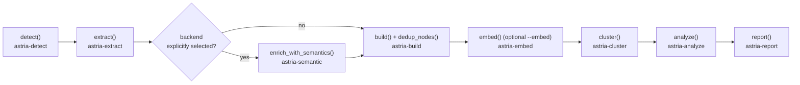
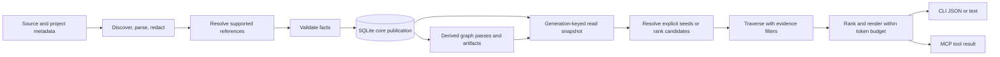

# Architecture

astria turns source code into a queryable knowledge graph. It uses AST-based extraction via tree-sitter for deterministic, fast analysis, stored in a SQLite database.

The project is a Rust workspace with 20 domain-specific crates and a Node.js CLI package.

- **Language**: Rust 2021
- **Build system**: Cargo + npm
- **Core dependencies**: `rusqlite` (persistence), `tree-sitter` (AST parsing), `petgraph` (graph algorithms), `napi-rs` (Node.js bindings), `fastembed` (local embeddings)

## Pipeline

The pipeline is orchestrated in `crates/astria-napi/src/pipeline.rs`. Validation runs before graph assembly: nodes need valid identity and type data, located definitions carry source provenance, and edges need existing endpoints and a valid confidence class. Unresolved stubs and references have no owning source file; an empty location is intentional for them. A corrupted extraction fails the run with the full violation list (`diagnose` reports the same classes of problem read-only on an existing graph).

1. **detect()** (`astria-detect`): Discovers files, classifies them (Code, Document, etc.), and uses a SHA-256 manifest to identify changed files since the last run. Manifest ingestion also covers dependency manifests — including Cargo workspace members and internal path dependencies (`crate::*` nodes with `crate_depends_on` edges).
2. **extract()** (`astria-extract`): Performs AST-based extraction using tree-sitter. Uses 42 registered language configurations; discovery and parser selection share `astria-core/src/languages.rs`, with AST rules in `src/langs/`.
3. **enrich_with_semantics()** (`astria-semantic`, optional): When `--backend` or `ASTRIA_LLM_BACKEND` explicitly selects a backend, extracts topics, concepts, and entities (including from images via vision) concurrently and caches the results. With `--judge jev`, a TypeSafe System One judge layer wraps the engine: batch file gating before extraction, per-file re-judging of relations/node types with calibrated `confidence_score` on edges, and suggested-question ranking.
4. **build()** (`astria-build`): Publishes extracted nodes and edges into SQLite. The extraction reference pass reconciles cross-file references before publication; deduplication runs as a derived pass.
5. **embed()** (`astria-embed`, optional `--embed`): Computes local node embeddings (fastembed/ONNX, no API key) and adds `similar_to` edges ahead of clustering, so community detection consumes semantic similarity. Also runs without the flag when embeddings already exist and the model is cached.
6. **cluster()** (`astria-cluster`): Performs community detection using the deterministic label propagation algorithm (via `petgraph`) and updates the `community` attribute on nodes.
7. **analyze()** (`astria-analyze`): Analyzes the graph to find "god nodes" (call stubs excluded), surprising cross-community connections, blast radius, and generates suggested questions.
8. **report()** (`astria-report`): Generates a plain-language `graph_report.md` summarizing the graph's structure and insights.

Default community labels use source module/package paths (`label_source = source`); LLM labels remain when their membership fingerprint still matches. Reports separate production-source orientation from documentation and tests, link findings to source, and show relationship evidence.

Pipeline stages separate extraction, persistence, and derived outputs. Semantic enrichment requires explicit backend selection; credentials alone do not activate it.

## Update and query consistency

AST parsing is incremental: unchanged source reuses its versioned extraction cache. The extraction reference pass reconciles the complete current corpus, so adding, removing or renaming a definition updates references from unchanged files. Name-derived call and import bindings carry `RESOLVED` provenance: the call or import syntax is extracted, but its endpoint is inferred from source names, qualified scopes and supported imports rather than compiler resolution. Ambiguous or missing targets remain `INFERRED`; already structural-ID `EXTRACTED`/`DECLARED` facts retain their provenance. `--detail high` includes only `EXTRACTED`/`DECLARED` evidence, so it excludes `RESOLVED`, `INFERRED` and `SEMANTIC` bindings.

Validated file-owned graph facts, the file manifest, and `_meta.graph_published_at` commit in one SQLite transaction. Every publication also mints a generation stamp (`_meta.graph_generation`, mirrored to `.astria/generation.txt`, carried in `graph.json`'s `_meta` and the report footer) so the database, JSON, and report of one build are matchable — and stamped before artifacts are written, so artifacts carry the generation they were produced under. Merge and global-store publications stamp inside their transactions; a merge publishes the database first and flips artifact files into place only after the swap succeeds, restoring the previous database if the swap fails. Query freshness (`graph_built_at`) uses that publication timestamp, so a failed later stage does not hide a successful core publication. The build configuration fingerprint includes deduplication options; changing those options triggers reconciliation. Extraction or semantic extraction errors leave that core graph and manifest unadvanced. Derived passes run after the core commit and rerun on subsequent updates, including unchanged updates, so a failed derived pass can be retried. These later passes and exported files are not part of the core transaction.

Semantic caches include source inputs and non-secret effective backend, endpoint, model, judge, and prompt configuration. Cached and fresh semantic results use the same merge path. Community labels and deep links also fingerprint their effective inputs and configuration. Source changes invalidate deep edges; restoring them requires another run with `--deep`, which replays matching cache entries or generates fresh links.

CLI and MCP queries share a generation-keyed bounded snapshot cache per process. The LRU defaults to 3 entries (`ASTRIA_SNAPSHOT_CACHE_ENTRIES` 1..=16), keyed by database path and publication generation (`_meta.graph_generation`). A hit shares an immutable in-memory snapshot; a generation advance invalidates it. Unstamped databases bypass the cache. Each entry holds a complete node/edge snapshot; separate CLI invocations have separate caches.

## From source files to an answer

The indexing path writes graph facts; the query path reads a published snapshot. Asking a question does not implicitly index missing files or activate an LLM backend.

### Extraction and reference resolution

Discovery and parser selection share the language registry, including supported extensionless shebang scripts. Extraction records declarations, locations, signatures, and syntax relationships. Incremental parsing reuses versioned caches; the reference pass still reconciles the current corpus so unchanged callers can bind to changed definitions.

Resolution uses lexical scope, supported import paths and project metadata, and available receiver-type evidence. Exact TypeScript aliases and supported workspace entries point to authored source. Local bindings stay within their function or block; instance-field inference requires unambiguous assignments. Conflicts and unknown receivers remain unresolved. Kotlin aliases, C# delegates, Dart typedefs, and Swift macros have dedicated declaration handling. See [language support](../reference/language-support) for the limits of registration.

Credential-shaped source text is redacted before retention and semantic requests. Redaction recognizes patterns; it does not make arbitrary confidential repository content safe to send to a provider. Semantic enrichment is explicitly selected, optional work with separate coverage and spend diagnostics.

### Evidence is part of the answer

| Evidence | What an agent may conclude | Limit |
| --- | --- | --- |
| `EXTRACTED` / `DECLARED` | A structural fact or declaration was recorded from its source evidence | Parsing does not prove runtime behavior |
| `RESOLVED` | Supported source evidence selected a unique endpoint | Name/type-derived binding is not compiler proof |
| `INFERRED` | A heuristic or possible relationship exists | Includes possible dispatch and learned relationships; verify before asserting a concrete call |
| `SEMANTIC` | Optional model-based enrichment proposed the relationship | Treat it as model-derived evidence |
| `AMBIGUOUS` | The stored evidence does not select one certain interpretation | Do not silently choose a target |

`--detail high` retains only `EXTRACTED`/`DECLARED` relationships. It is a provenance filter, not a numeric confidence cutoff. A low confidence score and an evidence class answer different questions. Unresolved nodes with no source location must never be cited as declarations in a referencing file.

### Retrieval and response delivery

1. Load an immutable snapshot keyed by database path and publication generation. The read transaction gives a consistent graph view; a changed generation invalidates the process-local cache.
2. Resolve explicit seeds by exact ID, then supported labels, bare names, or source suffixes. Ambiguous names disclose candidate IDs and locations. If no supplied seed resolves, return a miss without keyword fallback. Without explicit seeds, rank lexical candidates and optionally merge local embedding candidates when available.
3. Discover nodes with BFS or DFS to the requested depth. Directed traversal follows stored edge direction; undirected traversal can cross an edge backwards without reversing its reported source and target. Return qualifying relationships among selected nodes, including cycles and seed-to-seed edges.
4. Rank and render the selected evidence with source locations, graph freshness, and a continuation cursor when needed. The response tokenizer enforces the text budget. Structured metadata, including complete ambiguity candidates, is separate from that text budget; callers must budget the JSON envelope themselves.
5. Deliver through the shared Rust query engine. The Node CLI reaches Rust through NAPI; the MCP tool dispatcher reaches the same query engine. MCP exposes structured results and rendered context, not an independently generated interpretation of the graph.

The implementation entry points are [pipeline orchestration](https://github.com/Nodesify/astria/blob/v1.4.0/crates/astria-napi/src/pipeline.rs), [reference resolution](https://github.com/Nodesify/astria/blob/v1.4.0/crates/astria-extract/src/refs.rs), [snapshot loading](https://github.com/Nodesify/astria/blob/v1.4.0/crates/astria-query/src/store.rs), [seed selection and query ranking](https://github.com/Nodesify/astria/blob/v1.4.0/crates/astria-query/src/lib.rs), [traversal and rendering](https://github.com/Nodesify/astria/blob/v1.4.0/crates/astria-query/src/render.rs), and [MCP dispatch](https://github.com/Nodesify/astria/blob/v1.4.0/crates/astria-mcp/src/lib.rs).

### Failure and recovery boundaries

| Situation | Published state and response | Next action |
| --- | --- | --- |
| Extraction or semantic extraction fails | Core graph and successful manifest do not advance; incomplete semantic output is not cached as complete | Inspect `diagnose`, correct the cause, retry `update` |
| A derived stage fails after core publication | The successful core commit remains; artifacts or derived content may need reconciliation | Inspect freshness and retry the update; do not assume every output is one atomic bundle |
| Explicit seed is missing or ambiguous | Missing names and candidate metadata are reported | Choose an exact candidate ID or inspect source; do not invent an endpoint |
| Graph predates source or extraction rules | Freshness metadata discloses the mismatch | Run `astria update .` before relying on affected relationships |
| Text budget is exhausted | Output is bounded and may include a continuation cursor | Follow the cursor or narrow the question; absence from one page is not absence from the graph |

For a concrete agent procedure and machine-readable documentation entry points, see [AI workflow](../guides/ai-workflow).

## Crate responsibilities

| Crate | Responsibility |
| :--- | :--- |
| `astria-bolt` | Bolt client for exporting the graph to a live Neo4j database. |
| `astria-core` | Shared types (`FileType`, `GraphStats`), `AstriaError`, SQLite schema + migrations, path validation, sanitization, sensitive-path denylist. |
| `astria-paths` | Path normalization and `.astria` directory management. |
| `astria-detect` | File system scanning, `.astriaignore` support, and incremental change detection via SHA-256 hashes. |
| `astria-extract` | Tree-sitter AST traversal logic. Each language defines its own extraction rules (nodes, edges, docstrings). |
| `astria-embed` | Local embedding model (fastembed/ONNX, `jina-embeddings-v2-base-code` — code + English trained, so a natural-language description ranks its true function) powering `similar_to` edges and embedding-backed query recall — no API key, offline after the first model download. |
| `astria-build` | Persistent graph assembly; entity dedup (MinHash/LSH blocking + Jaro-Winkler verify) in `dedup.rs`. |
| `astria-cluster` | Deterministic community detection (stable labels, cohesion, modularity) using `petgraph`. |
| `astria-analyze` | God nodes, ranked surprising cross-community connections, blast radius (`affected.rs`, reverse reachability). |
| `astria-query` | Query engine: BFS/DFS (optionally directed), shortest path, explain, token-based node scoring, generation-keyed bounded snapshot cache shared per process. |
| `astria-mcp` | MCP stdio server exposing the graph to AI agents. |
| `astria-report` | Markdown generation for the final user-facing report. |
| `astria-semantic` | LLM semantic extraction, multi-backend (Claude / OpenAI-compatible / Gemini) with vision, chunking, and output validation. `--judge jev` wraps the selected engine with a TypeSafe System One judge layer: batch file gating before extraction, per-file re-judging of relations/node types with calibrated `confidence_score` on edges, and suggested-question ranking. |
| `astria-ingest` | URL ingestion (arXiv/tweet/webpage/image) with SSRF protection: scheme allowlist, per-hop redirect re-validation (manual redirect following), DNS-resolved address blocking (private/CGNAT/link-local, IPv4+IPv6), and slugified download filenames. |
| `astria-pdf` | PDF text extraction. |
| `astria-audio` | Audio/video transcription via the external `whisper-cli` binary (whisper.cpp) and `ffmpeg` demux — transcript markdown feeds the document extractor. |
| `astria-office` | Office document text extraction: `.docx` (via `word/document.xml`) and `.xlsx` (via calamine) become markdown for the document extractor. |
| `astria-gws` | Google Workspace shortcut ingestion: `.gdoc`/`.gsheet`/`.gslides` links are exported through the Drive API and become document nodes. Missing credentials degrade to a notice. |
| `astria-export` | Graph export: JSON, interactive HTML, GraphML, SVG, Neo4j Cypher (with push), FalkorDB openCypher (with Redis push). |

| `astria-napi` | The bridge between Rust and Node.js: pipeline orchestration, query surface, merge/diff, JSON/HTML/GraphML/SVG/tree/Cypher export, live Neo4j push, and health and risk reports. |
| `astria-cli` *(Node.js package)* | The user-facing CLI: argument parsing and installing AI skills. |

## Data model

### SQLite schema

The graph is stored in `.astria/db.sqlite`. The listing below is generated from the `CREATE`/`ALTER` statements in `crates/astria-core/src/db.rs` — run `node scripts/generate-schema-docs.mjs` after schema changes; the docs-sync CI check rejects drift.

<!-- schema:begin - generated by scripts/generate-schema-docs.mjs; do not edit by hand -->
- `nodes`: `id`, `label`, `file_type`, `source_file`, `source_line`, `docstring`, `community`, `degree_centrality`, `signature`, `metadata`, `repo`
- `edges`: `id`, `source`, `target`, `relation`, `confidence`, `confidence_score`, `source_file`, `source_line`, `context`
- `hyperedges`: `id`, `label`, `nodes`, `relation`, `confidence`, `confidence_score`, `source_file`
- `communities`: `id`, `label`, `cohesion`, `size`, `summary`, `label_source`, `member_hash`
- `file_manifest`: `file_path`, `content_hash`, `file_type`, `language`, `last_seen_at`, `size_bytes`, `extraction_status`, `extraction_notes`
- `extraction_cache`: `file_path`, `content_hash`, `language`, `nodes`, `edges`, `extracted_at`, `status`, `notes`
- `pipeline_runs`: `id`, `started_at`, `finished_at`, `status`, `files_processed`, `nodes_added`, `edges_added`, `llm_input_tokens`, `llm_output_tokens`, `llm_api_calls`
- `query_history`: `id`, `question`, `answer`, `path_taken`, `queried_at`
- `node_embeddings`: `node_id`, `dim`, `embedding`, `model`, `embedded_at`
- `query_pairs`: `source`, `target`, `question`, `hits`, `first_seen`, `last_seen`
- `_meta`: `key`, `value`
- `derived_text`: `file_path`, `content_hash`, `text`
- `memory_outcomes`: `question`, `outcome`, `updated_at`
<!-- schema:end -->

Notes: `node_embeddings` is populated only by `--embed` builds; `_meta` carries the schema version and build stamps (what `status` reads); while a process has the database open you will also see `db.sqlite-wal` / `db.sqlite-shm` sidecars (SQLite WAL mode).

### Relationship types

The canonical relation enumeration — structural, cross-layer, ingest, semantic, hyperedge, and global-graph families, each with its provenance class — lives in the [graph model](../reference/graph-model) reference. The docs-sync CI check cross-checks that table against the code in both directions (every emitted relation documented; every documented relation emitted or explicitly marked external-only).

Registration does not promise complete semantic support per language — see the [generated language table](../reference/language-support) for configured AST kinds.

## Persistence and performance

- **SQLite** — chosen for its zero-config nature and robust ACID properties, making it perfect for local analysis.
- **Incremental rebuilds** — AST parsing reuses unchanged cached files; reference reconciliation still considers the complete current corpus.
- **napi-rs** — provides near-native performance for the CLI while maintaining the ease of use of an npm package.
